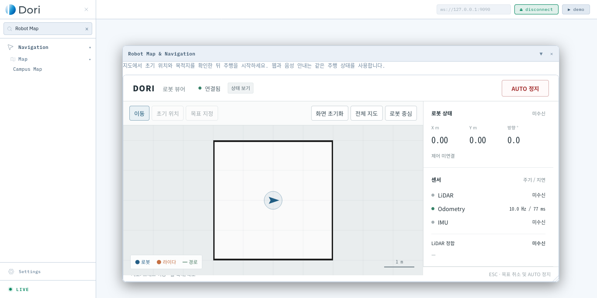

# 통합 검증 기록 — 2026-10-27

적용 기준은 [DORI AMM](../../../user/DORI-AMM.md), 기본 소스는 feature/control-and-navigation `ec23021`이다. main `d4cc1ae`는 이 기준에 포함돼 있으며, HRI와 웹을 다른 저장소에서 덮어쓰지 않고 같은 트리에서 통합했다.

## 실행 결과

| 검증 | 결과 및 기록 |
|---|---|
| ROS 전체 빌드 | 28개 패키지 성공 — [build.txt](build.txt) |
| Python 및 ROS 액션·BT 회귀 | 115 passed — [tests.txt](tests.txt) |
| CAN 오류·바퀴 속도/odometry C++ | CTest 3/3 passed — [tests.txt](tests.txt) |
| 프런트엔드 | ESLint, Vite build, Node 테스트 2/2 성공 — [web-build.txt](web-build.txt) |
| 설치·모델 읽기 점검 | `ok: true` — [deployment-check.json](deployment-check.json), 실행 환경 주의는 아래 참조 |
| 웹 목표 → 실제 Nav2 → 가상 차체 | 성공, 정지와 브라우저 lease 만료 포함 — [web-goal.json](web-goal.json) |
| 상대 전진 1 m | 오차 약 0.099 m, intent는 고정 fixture — [relative-1m.json](relative-1m.json) |
| HRI → 실제 Nav2 | QA 무이동, GUIDING → ARRIVED → IDLE 및 도착 발화 — [hri-nav2.json](hri-nav2.json) |
| 일시 장애물 재시도 | 약 4.95초 대기, 대기 중 출력 억제, 재개 후 도착 — [retry.json](retry.json) |
| 후진 복구 | 실제 Nav2 복구 실행, 후진 거리 제한 및 도착 — [reverse-recovery.json](reverse-recovery.json) |
| 후방 장애물 | 후진하지 않고 주행 억제 — [blocked-rear.json](blocked-rear.json) |
| 반대 목표 방향 | 불필요한 큰 회전 경로 억제 — [heading-test.json](heading-test.json) |
| 가상 마찰·모터 동특성 | 폐루프 도착 및 정지 — [motor-dynamics.json](motor-dynamics.json) |
| AMCL 위치 자동 정렬 | 정지 상태 보정, 주행/로컬 odometry 원점 변경 없음 — [auto-alignment-test.json](auto-alignment-test.json) |
| LiDAR → Cartographer → 지도 저장 | odometry 오차 약 0.00028 m, 지도 pose 오차 약 0.0094 m — [mapping.json](mapping.json) |
| 사용자 웹 재시도/음성 UI | 재시도 유지, 완료 발화, sound off — [browser-retry.json](browser-retry.json) |
| 통합 대시보드 브라우저 | 실제 HTTP/rosbridge, 합성 지도/로봇 표시, CSRF/origin, API, 연결 복구, TTS 출력 중복 방지 — [dashboard-browser.json](dashboard-browser.json) |
| 음성 모델 | 로컬 ONNX wake model·Whisper small 로딩/추론, 무음 오인식 없음 — [voice-models.json](voice-models.json) |
| 보존한 실측 설정 | 기준 소스와 동일함을 바이트 비교 — [calibration.json](calibration.json) |

[소스 SHA-256 목록](source-sha256.txt)을 함께 보관했다. 소스·launch 구문 검사 및 `git diff --check`도 통과했다. 실물 launch는 `--show-args`로 읽기 검사하고, 실제 OnProcessExit 처리기는 가짜 프로세스의 정상·오류 종료를 발생시켜 검증했다. 이 과정에서 실물 드라이버를 실행하지 않았다.

## 장애 주입 범위

실제 ROS 액션 서버/클라이언트로 동시 목표 수락 경쟁, 금지 모드/하드웨어 상태, NaN/비정상 pose, 수락 지연 뒤 취소, 비상 정지, 수락 timeout 후 늦은 목표 취소, 취소 거절/timeout 후 오류 유지 등을 검사했다.

운용 C++ BT와 Python LLM/TTS/중계 노드를 함께 실행해 QA, 미등록 목적지, 낮은 신뢰도, 마이크 반환, 실제 결과 전 도착 금지, 한국어 정지, 출입 장애 복구, 추적 소실·재획득, 제스처 STOP, 표정으로 허위 도착 판정 금지를 검사했다. Nav2를 제어 가능한 시험 서버로 바꾼 이 시험과 별도로, 실제 Nav2 폐루프 HRI 시험도 실행했다.

## 환경과 해석 한계

[environment.json](environment.json)의 환경은 Ubuntu 22.04 x86_64 / ROS Humble / Python 3.10이다. 시스템에 없던 rosbridge/rosapi와 PortAudio는 공식 apt 패키지를 임시 디렉터리에 풀어 시험 환경에 연결했다. sudo 암호가 필요한 시스템 설치는 수행하지 않았다. **실제 대상 로봇은 `scripts/install_dependencies.sh`로 정상 설치해야 한다.** 임시 `/tmp` 경로는 배포물이나 운용 스크립트에 포함하지 않았다.

합성 LiDAR/차체에는 실제 지면 미끄러짐, 하중, 구동기 온도, 전원 상태 및 CAN 장치가 없다. 무음 음성 모델 시험은 실제 wake word 인식률이나 한국어 음성 정확도를 증명하지 않는다. Firefox TTS는 SpeechSynthesis 호출을 관찰했고 스피커 소리를 녹음·측정하지 않았다. 시각 모델, 물리 카메라, 외부 LLM/Gemini API, GCP/gTTS 실제 재생은 이번 인수 범위에 포함되지 않는다. 실행 성능을 다른 CPU 아키텍처에서 측정한 것도 아니다.

시스템의 main 기능은 소스와 선택 launch 경로로 보존했다. 웹의 ROS PCM 오디오 모드는 외부 `/dori/audio/output` 생산자가 있을 때 사용하는 확장 경로이며, 기본 TTS는 로봇 로컬 재생 또는 브라우저 발화다. 브라우저 카메라 시험 패널은 압축 영상 발행 도구이며 실제 전방 카메라를 자동 대체하지 않는다. 실제 로봇의 사람/제스처/표정 인식은 설정한 RealSense 영상 경로를 사용한다.

최종 배포 승인에는 AMM 72-20의 현장 인수 기록이 추가로 필요하다. 이 디렉터리의 `ok: true`를 실제 로봇 주행 승인으로 해석하지 않는다.

